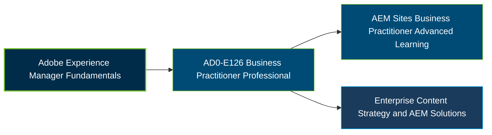

# Adobe Experience Manager Business Practitioner Professional Certification Exam Guide

A dedicated, comprehensive study guide and business reference repository for candidates preparing for the **Adobe Experience Manager Business Practitioner Professional Certification Exam (AD0-E126)**.

---

## Exam Overview

The Adobe AD0-E126 certification validates foundational knowledge of Adobe Experience Manager, including its capabilities, architecture, business applications, and implementation practices. AD0-E126 is an earlier exam version; Adobe's current certification listing identifies AD0-E138 for Adobe Experience Manager Business Practitioner Professional.

- **Exam Format**: Online proctored examination.
- **Target Audience**: AEM Business Practitioners, Solution Consultants, Business Analysts, Product Owners, and Solution Architects.
- **Prerequisites**: No formal mandatory prerequisite confirmed; foundational AEM knowledge and relevant practical experience are recommended.

---

## Core Exam Domains & Knowledge Areas

### 1. Education

- Identify Adobe Experience Manager features and core capabilities.
- Explain how AEM functionality supports business requirements.
- Understand training procedures and enablement for content editors.

### 2. Architecture

- Understand information architecture for on-premises and Adobe-hosted environments.
- Identify AEM integrations with third-party services.
- Understand roles, permissions, and caching approaches.

### 3. Business Analysis

- Match AEM modules and content management capabilities to business needs.
- Identify project stakeholders and collaboration responsibilities.
- Align business goals with development activities, budget, and project scope.

### 4. Setup and Implementation

- Apply AEM best practices when working with content components.
- Identify suitable implementation approaches for AEM features.
- Evaluate implementation choices against business requirements.

---

## Certification Path

The following diagram represents a suggested learning progression, not an official Adobe certification pathway.

---

## Recommended Practice & Study Resources

To prepare effectively, combine Adobe learning materials, AEM documentation, and objective-based practice:

- **CertsGate**: Explore [Adobe AD0-E126 study materials and practice resources](https://certsgate.com/exams/adobe/ad0-e126) to review relevant concepts and assess your knowledge.
- **Adobe Experience Manager Documentation**: Study the [AEM 6.5 documentation](https://experienceleague.adobe.com/docs/experience-manager-65.html?lang=en) and [AEM as a Cloud Service documentation](https://experienceleague.adobe.com/docs/experience-manager-cloud-service/content/home.html) to understand platform capabilities and implementation concepts.
